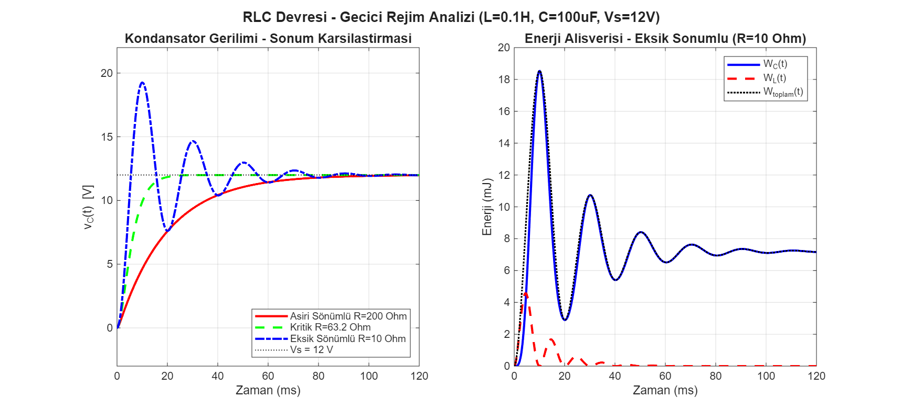
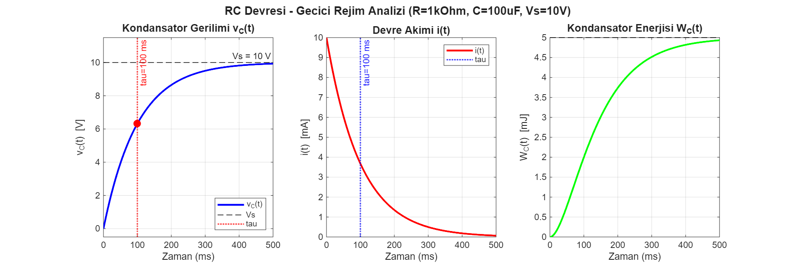
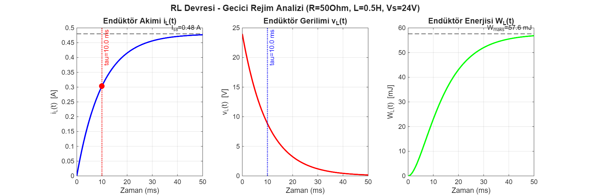

# Circuit Transient Analysis in MATLAB

Step-response analysis of first- and second-order circuits, written for a Circuit Analysis course at Yıldız Technical University. Each script solves the circuit analytically, prints the key values (time constant, damping, natural frequency) and plots voltage, current and stored energy. Code comments and plot labels are in Turkish.

| Script | Circuit | What it computes |
|---|---|---|
| [`RC_Devresi_Simulasyon.m`](RC_Devresi_Simulasyon.m) | RC (1 kΩ, 100 µF, 10 V) | τ = RC, capacitor voltage, current and energy |
| [`RL_Devresi_Simulasyon.m`](RL_Devresi_Simulasyon.m) | RL (50 Ω, 0.5 H, 24 V) | τ = L/R, inductor current, voltage and energy |
| [`RLC_Devresi_Simulasyon.m`](RLC_Devresi_Simulasyon.m) | Series RLC (0.1 H, 100 µF, 12 V) | Over-, critically and under-damped responses; energy exchange between L and C |

## Results

**Series RLC** — the same circuit with three resistances. At R = 10 Ω (ζ ≈ 0.16) the capacitor voltage overshoots to about 19 V before settling at 12 V; at the critical resistance R = 2√(L/C) ≈ 63.2 Ω it settles fastest without overshoot.

**RC circuit** — the capacitor reaches 63.2 % of the source voltage after one time constant (τ = 100 ms) and 99.3 % after 5τ.

**RL circuit** — inductor current rises to I = V/R = 0.48 A with τ = L/R = 10 ms.

## Run it

Open MATLAB in this folder and run any script, e.g. `RLC_Devresi_Simulasyon`. Plots are saved to `docs/`. Only base MATLAB is needed (no toolboxes).
